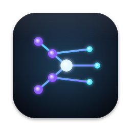

# Ante

**[anterm.app](https://anterm.app)** · [Download](https://github.com/ishan97/ante/releases/latest/download/Ante.dmg) · macOS 14+, Apple silicon

A native macOS terminal built as a workspace: projects and sessions in a sidebar, sessions that
land in History on quit — or reopen just as they were — splits, a global show/hide hotkey, themes, and shell integration that
never touches your rc files.

## Build

    ./scripts/bootstrap.sh     # installs xcodegen, generates Ante.xcodeproj
    ./scripts/test.sh          # tests every package, builds the app
    ./scripts/package.sh       # Release build → dist/Ante-<version>.dmg

Requires Xcode 26 and the Metal toolchain (`xcodebuild -downloadComponent MetalToolchain`).
`package.sh` signs ad-hoc by default; see **Distributing** below for a signed, notarized build.

## Configure

`~/.config/ante/config.toml`, hot-reloaded. Settings (⌘,) edits the same file and keeps your
comments. `[window] width` and `height` (fractions of the screen, default 0.8) set the size Ante
opens at, from the top-left of the screen; 0 makes it reopen at the size and place you left it. Themes go in `~/.config/ante/themes/*.toml`; import iTerm2 `.itermcolors` or Alacritty
`.toml` from Settings → Appearance.

## Updates

Ante checks `https://raw.githubusercontent.com/ishan97/ante/main/appcast.xml` once a day and
offers new versions through Sparkle's standard dialog; nothing else is sent, and the check can be
turned off in Settings → General → Updates (Ante → Check for Updates… still works). Downloads are
verified against the EdDSA key in the app before they are installed. The newest DMG is always at
`https://github.com/ishan97/ante/releases/latest/download/Ante.dmg`.

## Sessions

`⌘⇧S` (or the pinned **Sessions** entry in the sidebar) opens a board of every live pane, sorted
into **Working / Waiting for you / Idle**, with the agent in the foreground (Claude Code, Codex,
Aider, Gemini, Goose, Amp, OpenCode, Cursor, Pi, or a plain shell/command) and how long it has been
in that state. Below the board, an **Activity** strip shows a year of prompts per day, with streaks,
read from the agents' own history files. **History** lists past sessions straight from each agent's
storage — Claude Code (`~/.claude/projects`), Codex (`~/.codex/sessions` and `archived_sessions`),
OpenCode (`~/.local/share/opencode/opencode.db`), Pi (`~/.pi/agent/sessions`) — plus agent
sessions closed in Ante (plain shells have nothing to resume, so they are not kept). Click an
agent's own entry to open a pane in that project and resume it (`claude --resume …`,
`codex resume …`, `opencode --session …`, `pi --session …`). An Ante entry opens a pane in that
folder and resumes the same conversation when Ante knew its id, otherwise it opens the agent's
session picker (`claude --resume`, `codex resume`).

"Waiting for you" is definite when an agent hook says so and probable when an agent has been
quiet for `[agents] quiet_seconds` (default 8). The moment a session moves into that column Ante
posts a macOS notification (click it to jump to the session) and plays the sound you pick under
Settings → Agents (`[agents] notify`, `notify_sound`); the Dock icon counts waiting sessions. Settings → Agents can install the Claude Code
hook (into `~/.claude/settings.json`, backed up; removable) for the definite signal.

### Reopening sessions

By default quitting files agent sessions into History and the next launch starts with one fresh
session. Turn on Settings → General → **Reopen sessions when Ante starts** (`[sessions] restore =
true`) and quitting keeps them instead: every session comes back with its name, its splits and
each pane's folder, and a pane that was running Claude Code, Codex, OpenCode or Pi types the
agent's resume command once its shell is ready (never if you have started typing there). That is
the exact conversation when Ante knows its id — from the agent's command line, or from the Claude
Code hook when no other pane runs Claude in that folder — and otherwise the agent's latest one in
the folder (`claude --continue`, `codex resume --last`, `opencode --continue`, `pi --continue`).
When two panes ran the same agent in one folder without known ids, each opens the agent's picker
instead (`claude --resume`, `codex resume`; OpenCode and Pi start a new one), so they never land
in the same conversation. The
layout is kept current as you work, so a crash restores too; turn the setting off and the next
launch files those agent sessions into History as usual. Screen contents are never saved, and
other commands are not run again. A pane whose folder is gone opens in its project instead, without
resuming anything.

## Projects

**Add Project…** at the bottom of the sidebar opens an existing folder. The folder button beside
it (or **New Project Folder…** in the command palette) makes a new one: type a name, and Ante
creates the folder beside your most recent project (Change… picks another place), adds it as a
project and opens a session in it. Right-click a project for **New Folder Inside…**, which makes
the folder inside that project and adds it as a project of its own.

Drag a session in the sidebar to reorder it, or onto another project to move it there (a line
shows where it will land; let go outside the sidebar to cancel). Right-click a session for
**Move to Project** to do the same from the menu. The session keeps running and keeps its folder;
only where it is listed changes.

## Tokens

The flame in the toolbar shows how many tokens your agents used in the last 24 hours, all of them
together. Click it for 7, 30, 60 and 90 days, 6 months and a year, each split by agent, by model
and into input, output and cache. The numbers are added up from the agents' own logs on this Mac —
Claude Code transcripts, Codex rollouts (and Codex's thread index for threads whose rollout is
gone), OpenCode's database, Pi sessions and Gemini CLI chats — read only, and nothing is sent
anywhere. Every agent with tokens in the last year stays listed in every window, with a dash where
it used none. The first count reads every log once in the background; after
that only what the agents appended is read, every five minutes and whenever the popover opens.

## Tips

Every few hours a short tip slides into the bottom-right corner: the show/hide hotkey, ⌘↩, the
Sessions board and the like, always with your own key bindings. Each tip comes back at most five
times; "Don't show again" retires one for good, and Settings → General → Tips turns them off (or
brings them all back).

## Keys

| | |
|---|---|
| ⌘T / ⌘W | new session / close pane |
| ⌘D / ⌘⇧D / ⌘⌥D / ⌘⌥⇧D | split right / down / left / up |
| ⌘⌥←↑→↓ | focus pane |
| ⌘1–9, ⌘⇧[ ] | jump between sessions |
| ⌘F | find in scrollback |
| ⌘K | clear pane |
| ⌘⌫ | erase everything you have typed at the prompt — all of a Claude Code or Codex draft, however many lines, or the shell's line — without Esc, so a running agent keeps going. Other programs get ⌃U, as in iTerm2 (⌥⌫ deletes a word) |
| ⌘↩ | fill screen (menu bar and Dock slide away); press again to go back. The hotkey hides and shows the window as it is |
| ⌘= / ⌘- / ⌘0 | bigger / smaller / actual text size (Monaco 12 by default, like iTerm2) |
| ⌘⇧S | sessions board |
| ⌘⌥S | show / hide the sidebar |
| ⌘⇧O | insert file path (or drop files onto the terminal) |
| ⌘⇧T | to-do list & notes (the checklist button in the toolbar shows how many are open) |
| — | focus timer (the timer button in the toolbar; 25/5 by default, long break every fourth block) |
| ⌘⇧P | command palette |
| ⌘↑ / ⌘↓ | previous / next command |
| ⌘⇧A | select last command output |
| ⌘-click | open link or file |
| ⌥` | drop Ante over the current app; press again to hide and return to it (rebind in Settings) |

Every split pane has a close button; the cursor is a steady block by default (`[cursor]` in config). Rebind these under Settings → Keys (or `[keys]` in config.toml).

## Layout

`Packages/AnteCore` (model, state, config), `AnteTerm` (SwiftTerm + OSC 133/7 tee), `AnteTheme`,
`AnteUI` (SwiftUI shell), `AntePanel` (global hotkey). Design notes and reviews live under `docs/`.

## Brand

The icon is the neural chevron: a prompt `>` built from glowing nodes and links — a terminal
with an AI inside it. It is drawn by `scripts/render-icon.swift` at every size
(`swift scripts/render-icon.swift 1024 out.png`; `docs/brand/ante-icon-256.png` is a render).

## Versioning

Ante follows [semantic versioning](https://semver.org): **major** for changes that break existing
configs or behaviour people rely on, **minor** for new features, **patch** for fixes only. The
version lives in `project.yml` (`CFBundleShortVersionString`); the build number
(`CFBundleVersion`) is the commit count, which Sparkle compares, so it always grows.
`scripts/prepare-release.sh <version>` stamps both, commits, publishes and tags.

## Distributing

`scripts/package.sh` builds `dist/Ante-<version>.dmg`. Ad-hoc signed by default, which is fine on
your own Mac; anyone else gets Gatekeeper's "Apple could not verify" warning. A real release is
signed and notarized through Xcode and then fed to Sparkle:

1. `scripts/prepare-release.sh <version>` — stamps the version and build number, commits, publishes
   the tree and tags it `v<version>`.
2. In Xcode: Product → Archive → Distribute App → Direct Distribution → Upload. When Apple's
   notarization finishes, Export the app.
3. `scripts/dmg-from-app.sh <exported Ante.app>` — wraps it in a DMG, staples the ticket, signs the
   DMG for Sparkle (the private key from `generate_keys` in your login keychain) and updates
   `appcast.xml`.
4. `gh release create v<version> dist/Ante.dmg --title "Ante <version>"`, then commit
   `appcast.xml` and `scripts/publish.sh "release: <version> appcast"`. Running copies see the
   update within a day.

With a Developer ID certificate in the local keychain and a notarytool profile
(`xcrun notarytool store-credentials ante …`), `ANTE_SIGN_IDENTITY=auto scripts/package.sh` does
steps 2 and 3 in one go; `ANTE_NOTARIZE=0` skips the notary submission (the signature still
fetches a timestamp from Apple) — enough for your own Macs, not for others.

## License

MIT — see `LICENSE`. Bundled fonts, colour schemes, and Swift packages keep their own licences,
listed in `THIRD_PARTY_NOTICES.md`. Contributions are welcome; see `CONTRIBUTING.md`.
